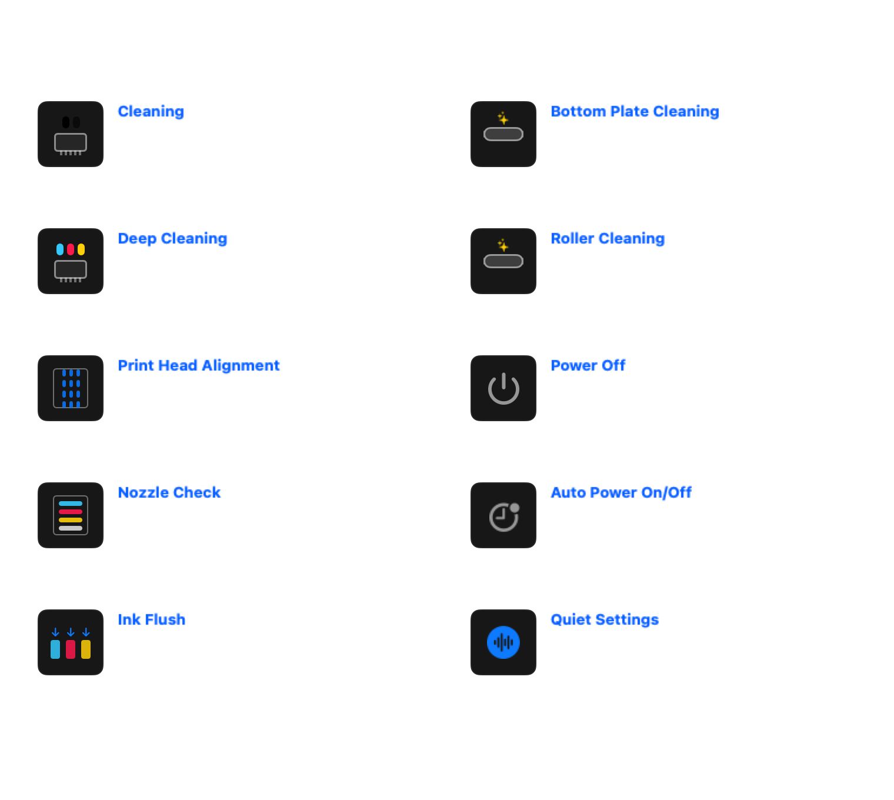

# Canon PIXMA Printers — Mac Assistant

Native macOS maintenance app for Canon PIXMA ink-tank printers over Wi‑Fi (built and tested with **G3010**).

Does **not** use or decompile Canon Windows software. Protocol notes informed by
[pixma-rs](https://github.com/pdrgds/pixma-rs) (MIT OR Apache-2.0) and public Remote UI / CUPS behaviour.



## Features

- **Bonjour discovery** of printers on the local network (`_ipp._tcp`), plus manual IP entry
- **Password-less login** on factory setups: reads the serial over SNMP and uses it as the Remote UI password, then stores it in Keychain
- **Maintenance actions** with option sheets where the printer UI has submenus:
  - Cleaning / Deep Cleaning
  - Print Head Alignment (automatic or print alignment values)
  - Nozzle Check
  - Ink Flush
  - Remaining Ink Notification Settings
  - Bottom Plate Cleaning / Roller Cleaning
  - Power Off (CHMP)
  - Auto Power On/Off
  - Quiet Settings
  - Custom Settings
- **CUPS / Gutenprint path** for cleaning, nozzle check, and head alignment when a matching queue exists (no Remote UI password needed)
- **Printer status** view from Remote UI
- Original icons (not Canon artwork)

## Requirements

- macOS 14+
- Xcode 15+ (or newer) to build
- Printer on the same LAN (Wi‑Fi)
- **Local Network** permission on first launch (System Settings → Privacy & Security → Local Network)
- Optional: a CUPS queue with Gutenprint for password-less cleaning / nozzle / align

## Build

Open `G3010Assistant/G3010Assistant.xcodeproj` in Xcode and Run.

`xcodebuild` fails when `xcode-select` points at Command Line Tools. Point it at the full Xcode developer directory:

```bash
export DEVELOPER_DIR=/Applications/Xcode.app/Contents/Developer
cd G3010Assistant
xcodebuild test -scheme G3010Assistant -destination 'platform=macOS'
xcodebuild build -scheme G3010Assistant -destination 'platform=macOS'
```

The app is signed locally (“Sign to Run Locally”). It is not notarized for distribution outside your Mac.

## Printer password

On many G3010 printers the factory Remote UI password is the **serial number**. The app reads that serial over public SNMP and tries it automatically. You are only prompted if that fails (custom password).

## Notes

- Power Off sends a CHMP PowerOff to the printer; the connection drop after shutdown is treated as success.
- Protocol capture notes for Remote UI forms live under `docs/captures/`.
- Not affiliated with Canon. PIXMA and related names are trademarks of their owners.

## License

MIT — see [LICENSE](LICENSE).
